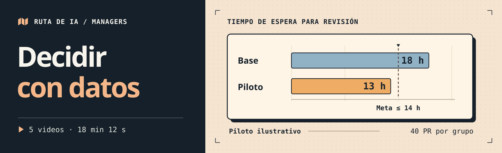
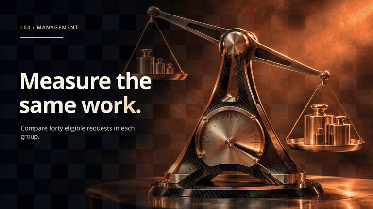

# Managers · Cómo decidir si ampliar un piloto de IA

Un equipo quiere acortar la espera de revisión de sus PR. Acompaña el piloto desde la elección de herramienta hasta la decisión de ampliarlo, ajustarlo o pausarlo. Todos los cálculos se hacen sobre el mismo caso simulado.

**5 episodios · 18:12 en total.** Narración en inglés, subtítulos seleccionables y un capítulo por escena. En el selector de audio puedes elegir la mezcla con diseño sonoro o la voz sola.

[Descargar el primer episodio (L01)](https://github.com/Finithe-Phoenix/Path-Level-Managers-IA/raw/v3.0.0/videos/L01.mp4) · [Editar o reconstruir los videos](PRODUCCION.md)

Una balanza de cobre abre la ruta. En L04 puedes seguir el tiempo del piloto, la calidad y el coste hasta la decisión de continuar o detenerlo.

## Temario

Selecciona el título para descargar el video. Puedes activar los subtítulos en tu reproductor o descargar el archivo SRT de cada episodio.

| Episodio | Qué harás en pantalla |
| --- | --- |
| **L01** · [Choose a Model and Tool for a Business Task](https://github.com/Finithe-Phoenix/Path-Level-Managers-IA/raw/v3.0.0/videos/L01.mp4) 3:35 · [SRT](https://github.com/Finithe-Phoenix/Path-Level-Managers-IA/raw/v3.0.0/subtitles/L01.en.srt) | Compara dos modelos aprobados con los mismos casos de aceptación y documenta la elección de herramienta. |
| **L02** · [Decide What an Agent Can Do](https://github.com/Finithe-Phoenix/Path-Level-Managers-IA/raw/v3.0.0/videos/L02.mp4) 3:44 · [SRT](https://github.com/Finithe-Phoenix/Path-Level-Managers-IA/raw/v3.0.0/subtitles/L02.en.srt) | Asigna lecturas, ediciones y aprobaciones a sus responsables. Decide qué hacer si el agente solicita una dependencia extra. |
| **L03** · [Design a Pilot Around a Real Bottleneck](https://github.com/Finithe-Phoenix/Path-Level-Managers-IA/raw/v3.0.0/videos/L03.mp4) 3:40 · [SRT](https://github.com/Finithe-Phoenix/Path-Level-Managers-IA/raw/v3.0.0/subtitles/L03.en.srt) | Mide la espera de revisión en horas hábiles y establece los grupos de comparación y umbrales del piloto. |
| **L04** · [Measure Review Time, Quality, and Cost](https://github.com/Finithe-Phoenix/Path-Level-Managers-IA/raw/v3.0.0/videos/L04.mp4) 3:35 · [SRT](https://github.com/Finithe-Phoenix/Path-Level-Managers-IA/raw/v3.0.0/subtitles/L04.en.srt) | Separa espera y trabajo activo. Calcula tasas de retrabajo y costo por PR con los mismos denominadores. |
| **L05** · [Decide Whether to Expand, Adjust, or Pause](https://github.com/Finithe-Phoenix/Path-Level-Managers-IA/raw/v3.0.0/videos/L05.mp4) 3:37 · [SRT](https://github.com/Finithe-Phoenix/Path-Level-Managers-IA/raw/v3.0.0/subtitles/L05.en.srt) | Aplica los umbrales acordados, elige el ajuste y deja por escrito qué evidencia necesitarás para la siguiente decisión. |

Ver un fragmento animado de L04

## Fuentes editables

Para preparar una nueva edición, empieza por el guion y las referencias técnicas de cada escena. El repositorio también guarda los dibujos, la toma original de voz, el audio final y sus marcas de tiempo. [Guiones y referencias](lessons/episodes.json) · [Guía de producción](PRODUCCION.md) · [Guía para agentes](AGENTS.md) · [Descargar las fuentes de v3.0.0 en ZIP](https://github.com/Finithe-Phoenix/Path-Level-Managers-IA/archive/refs/tags/v3.0.0.zip).

[Consultar la edición anterior](https://github.com/Finithe-Phoenix/Path-Level-Managers-IA/releases/tag/v2.0.0).

## Otras rutas

[Básico](https://github.com/Finithe-Phoenix/Path-Level-1-IA) · [Medio](https://github.com/Finithe-Phoenix/Path-Level-2-IA) · [Avanzado](https://github.com/Finithe-Phoenix/Path-Level-3-IA)
